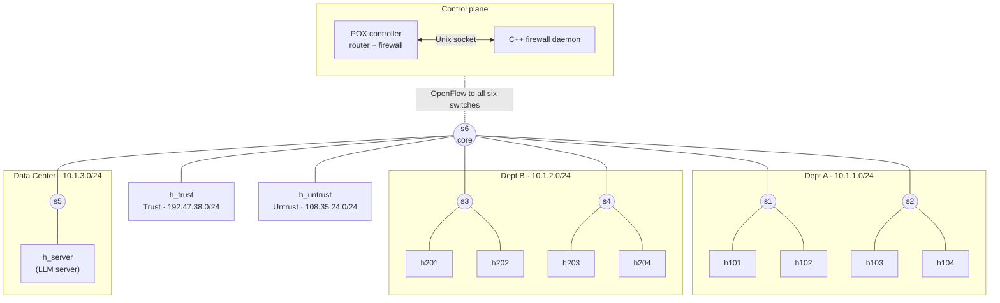

# Mininet Zone Segmentation

A software-defined router and firewall that splits a simulated company network into security zones, built with Mininet, the POX controller, and a C++ policy daemon.

[](https://github.com/lmdelros/mininet-zone-segmentation/actions/workflows/ci.yml)



## Highlights

- **The controller is the router and the firewall.** There's no firewall appliance and no static switch rules: a custom [POX](https://github.com/noxrepo/pox) controller answers ARP for every zone's gateway, routes between zones, and enforces the access policy.
- **Routed traffic at switch speed.** After the controller allows a connection's first packet, it installs OpenFlow rules so the switches route the rest of the connection themselves, including the TTL decrement. Routed throughput went from 4–9% of same-zone throughput to 93–100% (18.7 → 199 Mbit/s in comparable runs), and average ping dropped from about 9 ms to 1–2.5 ms.
- **Floods of blocked traffic stay off the controller.** A blocked connection gets a drop rule on the switch it entered, so in a flood of 500 blocked pings, 1 reaches the controller instead of all 500.
- **Stateful firewall.** The rules decide who may *start* a connection, and a connection-tracking table lets replies back in. Dept B can ping Trust, but Trust still can't start a ping to Dept B.
- **Blocks IP and ARP spoofing.** A packet's zone comes from the switch port it arrived on, which a host can't fake, and packets whose source IP doesn't match that zone are dropped.
- **Policy decisions in C++.** A standalone C++ daemon makes the allow/deny decision over a 13-byte binary protocol on a Unix socket, with the Python implementation as a fallback.
- **Tested with real traffic.** A Docker-based live test sends pings and TCP connections between every pair of zones, checks connection tracking and the switch rules for routed and blocked traffic, and runs both spoofing attacks (61 checks). 283 unit tests cover the rules, connection tracking, the wire protocol, and agreement between the Python and C++ implementations. Everything runs in CI on every push.
- **Measured honestly.** The benchmark shows the C++ daemon is 5–11x *slower* per decision than in-process Python for this small rule set, and the [design notes](docs/design.md#benchmark-c-daemon-vs-in-process-python) explain why.

## Overview

The network models a small company with two office floors (Dept A and Dept B), a data center that hosts an LLM server, and two outside zones: a trusted partner network and an untrusted one. Each zone has its own subnet. In [software-defined networking (SDN)](https://en.wikipedia.org/wiki/Software-defined_networking), switches forward packets but a central controller decides what they do, so all routing and filtering logic lives in one program instead of being configured on each device.

Here, the switches send any packet they don't have a rule for to the controller over [OpenFlow](https://en.wikipedia.org/wiki/OpenFlow). The controller works out which zone the packet came from and where it's going, asks the firewall whether that's allowed, and either drops it or routes it to the destination like a real router hop. For an allowed connection, it also installs rules on the switches, so the rest of that connection's packets are routed without the controller. The goal is to show zone segmentation, the practice of splitting a network so that a compromised machine in one zone can't reach everything else, with the most sensitive system (the LLM server) fully isolated from both outside zones.

### Access policy

| # | From | To | Policy |
|---|---|---|---|
| 1 | Untrust (`h_untrust`) | Data center (`h_server`) | Block all IP traffic |
| 2 | Untrust | Dept A, Dept B, data center | Block ICMP (ping) |
| 3 | Trust (`h_trust`) | Data center | Block all IP traffic |
| 4 | Trust | Dept B | Block ICMP |
| 5 | Trust | Dept A | Allow everything |
| 6 | Dept A | Dept B, both directions | Block ICMP |
| 7 | Data center | Trust, Untrust | Block all IP traffic |
| 8 | Any host | Same zone, non-IP (e.g. ARP) | Flood within the zone |
| 9 | Any host | Anything else between known zones | Allow and route |

The rules decide who may start a connection. Replies to an allowed connection are let back in even when a rule blocks that direction, so Dept B can ping Trust although rule 4 blocks Trust → Dept B ICMP. Traffic to or from an address outside all five subnets is denied before any of these rules apply.

## Tech stack

- **[Mininet](http://mininet.org/) 2.3**: emulates the 11 hosts, 6 switches, and links on one Linux machine ([`topology.py`](topology.py)).
- **[Open vSwitch](https://www.openvswitch.org/)**: the virtual switches; they follow the controller's OpenFlow instructions.
- **[POX](https://github.com/noxrepo/pox) (ichthyosaur branch, Python 3)**: the SDN controller framework that runs the router and firewall logic ([`controller.py`](controller.py)).
- **OpenFlow 1.0**: the protocol between the switches and the controller.
- **C++11**: the standalone firewall daemon ([`cpp/firewall_daemon.cpp`](cpp/firewall_daemon.cpp)), built with `make` and g++.
- **Python 3.10+**: the controller, the rule logic ([`firewall_rules.py`](firewall_rules.py)), the daemon client, and the tests.
- **pytest**: unit tests, including a suite that compiles the C++ daemon and checks it against the Python rules.
- **Docker**: a reproducible environment that runs the whole network and the live test with one command.
- **GitHub Actions**: runs the unit tests and the live test on every push.

## Getting started

The quickest way to see it work is the Docker live test, which builds and starts everything (Open vSwitch, the C++ daemon, POX, and the Mininet network), sends real traffic, and reports the results.

### Requirements

- [Docker](https://docs.docker.com/get-docker/) (Docker Desktop on Windows or macOS, or Docker Engine on Linux), with about 600 MB of free disk space for the image.
- [Git](https://git-scm.com/).

Tested on Docker Desktop for Windows (WSL 2 backend) and on GitHub Actions' Ubuntu runners. The container needs `--privileged` because Mininet creates virtual network interfaces and network namespaces.

### Run the live test

1. Clone the repository:

   ```bash
   git clone https://github.com/lmdelros/mininet-zone-segmentation.git
   cd mininet-zone-segmentation
   ```

2. Build the test image (takes a few minutes the first time):

   ```bash
   docker build -t zone-seg-live docker/
   ```

3. Run it from the repository root:

   ```bash
   docker run --rm --privileged -v "$PWD:/src:ro" zone-seg-live
   ```

   In Windows PowerShell, use `"${PWD}:/src:ro"` instead of `"$PWD:/src:ro"`.

No environment variables or configuration files are needed.

### Expected output

Each check prints `PASS` or `FAIL`, followed by the measured reachability between zones. Abridged:

```text
*** Zone policy matrix (ping = ICMP, tcp = TCP connect)
  [PASS] h101      -> h201      ping blocked
  [PASS] h101      -> h201      tcp  allowed
  [PASS] h_untrust -> h_server  tcp  blocked
  ...
*** Stateful firewall: replies pass, reverse connections do not
  [PASS] h201 pings h_trust (reply passes despite rule 4)
  [PASS] h_trust still cannot start a ping to h201
  [PASS] h101 pings h_untrust (reply passes despite rule 2)
  [PASS] h_untrust still cannot start a ping to h101
*** Routed connections get switch flow rules (h201 -> h_server)
  [PASS] every reply arrives with TTL decremented once  (TTLs: 63, 63, 63, 63, 63)
  [PASS] core switch has a routing rule for the connection
  [PASS] switch forwarded the later packets itself  (5 packets matched the rule)
*** Blocked flood stays off the controller (h_untrust -> h_server)
  [PASS] controller saw the flood start but at most 10 of 200 pings  (1 reached the controller)
  [PASS] attacker's switch holds a drop rule for the connection
*** IP spoofing: h_untrust forges a Trust source IP toward h101
  [PASS] control: honest Trust ping reaches h101
  [PASS] attacker emitted spoofed packets  (3 sent)
  [PASS] none reached h101  (0 received)
*** ARP spoofing: h101 claims h_server's IP
  [PASS] before: h201 reaches h_server
  [PASS] after: a new h201 connection still reaches the real h_server
  [PASS] controller logged the spoofed ARP drop
...
*** ALL CHECKS PASSED
```

The reachability matrix it measures (row = source, column = destination; `ping / tcp`; `ok` = connects, `--` = blocked):

| From \ To | Dept A | Dept B | Data center | Trust | Untrust |
|---|---|---|---|---|---|
| **Dept A** | same zone | -- / ok | ok / ok | ok / ok | ok / ok |
| **Dept B** | -- / ok | same zone | ok / ok | ok / ok | ok / ok |
| **Data center** | ok / ok | ok / ok | same zone | -- / -- | -- / -- |
| **Trust** | ok / ok | -- / ok | -- / -- | same zone | ok / ok |
| **Untrust** | -- / ok | -- / ok | -- / -- | ok / ok | same zone |

The matrix isn't symmetric: Dept B can ping Trust, but Trust can't ping Dept B, because only the side the rules allow can start a connection. See [connection tracking](docs/design.md#connection-tracking).

## Usage: explore the network interactively

To type commands into the network yourself, run it on a Linux machine or VM with Mininet installed. These steps match the Docker image's setup.

### Requirements

- Ubuntu 22.04 (or similar Linux) on a VM or real machine. Mininet needs Linux network namespaces, so it won't run directly on Windows or macOS.
- Mininet 2.3, Open vSwitch, g++, make, git, and Python 3.10 or newer (installed below).

### Steps

1. Install the system packages:

   ```bash
   sudo apt-get update
   sudo apt-get install -y mininet openvswitch-switch g++ make git tcpdump netcat-openbsd
   ```

   `tcpdump` and `netcat-openbsd` are only needed if you also want to run the live test directly on the VM.

2. Get POX, the Python 3 branch:

   ```bash
   git clone https://github.com/noxrepo/pox ~/pox
   git -C ~/pox checkout ichthyosaur
   ```

3. From this repository's root, copy the controller, its three helper modules, and the policy file into POX's `ext/` folder, where POX looks for components:

   ```bash
   cp controller.py firewall_rules.py firewall_client.py conntrack.py policy.json ~/pox/ext/
   ```

4. Build and start the C++ firewall daemon. It listens on `/tmp/zone_firewall.sock`. To use the Python firewall instead, skip this step and set `USE_CPP_FIREWALL = False` in `controller.py` before copying it.

   ```bash
   make -C cpp
   ./cpp/firewall_daemon &
   ```

5. Start the controller:

   ```bash
   cd ~/pox && ./pox.py controller
   ```

6. In a second terminal, from this repository's root, start the network:

   ```bash
   sudo python3 topology.py
   ```

7. At the `mininet>` prompt, try some traffic:

   ```text
   mininet> h_trust ping -c 2 h101      # replies: Trust may reach Dept A (rule 5)
   mininet> h101 ping -c 2 h201         # 100% packet loss: Dept A can't ping Dept B (rule 6)
   mininet> h_untrust ping -c 2 h_server  # 100% packet loss: Untrust can't reach the server (rule 1)
   ```

   The controller terminal logs a `DROP` line for every packet it blocks. Type `exit` to stop the network.

## Running tests

Unit tests (any OS; the C++ comparison tests need Linux and g++ and are skipped elsewhere):

```bash
python -m pip install pytest
python -m pytest
```

The live end-to-end test is the Docker command from [Getting started](#run-the-live-test). On a Mininet VM with POX already running, you can also run it directly:

```bash
sudo python3 integration/live_test.py
```

[GitHub Actions](https://github.com/lmdelros/mininet-zone-segmentation/actions/workflows/ci.yml) runs both on every push to `main` and on pull requests.

The performance test measures throughput (with iperf3) and ping latency for routed and same-zone traffic, then floods blocked pings and counts how many reach the controller. It uses the same image (about 2 minutes):

```bash
docker run --rm --privileged -v "$PWD:/src:ro" -e TEST_SCRIPT=perf_test.py zone-seg-live
```

Absolute numbers depend on the machine, so compare the two paths within one run. Results are in the [design notes](docs/design.md#flow-rules-for-routed-traffic).

## Learn more

[Design notes](docs/design.md) cover how routing works step by step, the flow rules and their performance results, connection tracking, the C++ daemon and its wire protocol, anti-spoofing, the benchmark results, and the bugs the tests found.

## Project structure

```text
.
├── controller.py          # POX controller: ARP, routing, anti-spoofing, firewall calls
├── firewall_rules.py      # Zone definitions and allow/deny rules (pure Python)
├── conntrack.py           # Connection tracking: lets replies to allowed connections back in
├── firewall_client.py     # Python client for the C++ daemon's socket protocol
├── topology.py            # Mininet network: 6 switches, 11 hosts
├── bench_firewall.py      # Latency benchmark: Python vs. C++ daemon
├── cpp/                   # C++ firewall daemon and Makefile
├── tests/                 # pytest unit tests
├── integration/           # Live Mininet test and performance test
├── docker/                # Test image and its startup script
└── docs/design.md         # Design notes
```

## Roadmap and known limitations

- **Spoofed packets still reach the controller one by one,** so each is logged as a security warning. Drop rules for them would trade that visibility for less controller load.
- **Policy is hard-coded in two places,** Python and C++, kept in sync by tests. Moving it into one config file would remove the duplication.
- **Switch port numbers are hard-coded** in `controller.py` to match `topology.py`'s link order, so changing the topology means updating both.
- Logging and metrics for rule hits and drop counts.

## Project status

Actively developed as a personal portfolio project.

## Contributing

Issues and suggestions are welcome. For anything larger than a small fix, please [open an issue](https://github.com/lmdelros/mininet-zone-segmentation/issues) first to discuss it.

## Author

**Luis del Rosario**: [GitHub](https://github.com/lmdelros)
